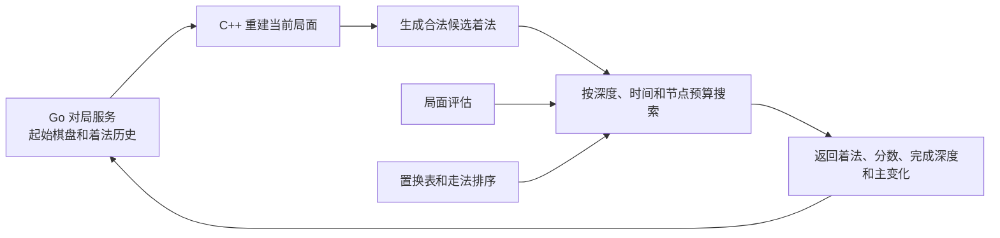
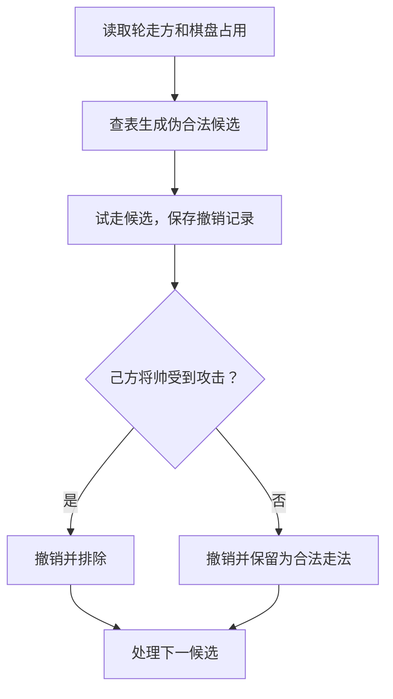
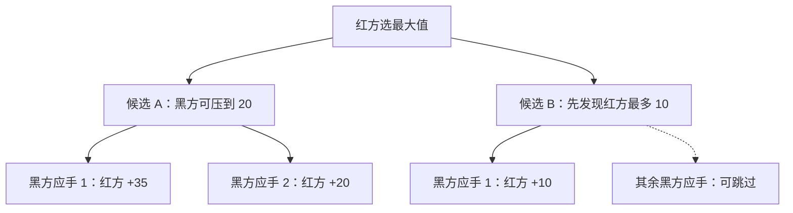
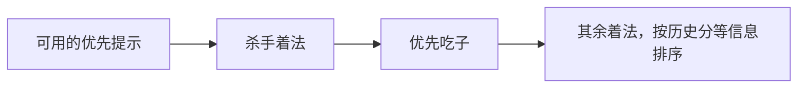
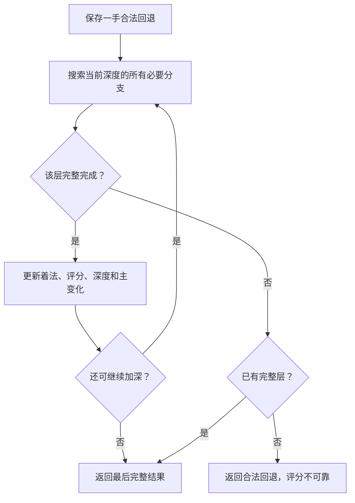
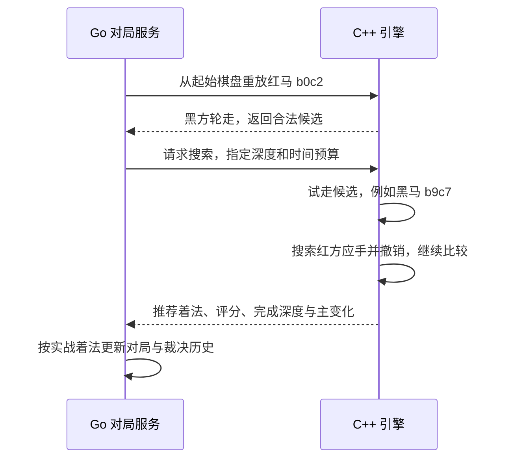

# 中国象棋引擎原理

中国象棋引擎把一次选招拆成三个问题。**哪些着法合法？每个局面有多好？在有限时间内，应优先算哪些变化？** 当前实现用 C++ 管理棋盘、评估局面并搜索着法，Go 服务负责正式对局的状态和裁决。



## 1. 用数字表示棋盘

象棋棋盘有 9 列、10 行，共 90 个交叉点。引擎的坐标从红方底线开始编号，横坐标为 `a` 到 `i`，纵坐标为 `0` 到 `9`。内部数组从黑方底线开始存放，所以索引是 `(9 - rank) × 9 + file`，其中 `file` 从 0 计数。

```text
黑方底线  a9 b9 c9 d9 e9 f9 g9 h9 i9   索引 0–8
              ……
红方底线  a0 b0 c0 d0 e0 f0 g0 h0 i0   索引 81–89
```

同一局面有几种互补的表示。格点数组可以回答“这个点上是哪枚棋子”，棋子表可以回答“这枚棋子在哪”。**位棋盘（BitBoard）**用一个比特表示一个位置，适合快速求交集、合并攻击范围和统计棋子。本实现用四个 32 位整数分段存放，每段使用 27 位。行、列占用掩码则记录每条线上哪些点有棋子，方便查询直线走法。

| 数据 | 回答的问题 |
| --- | --- |
| 格点与棋子数组 | `b0` 有棋子吗？红方那匹马现在在哪？ |
| 按阵营、棋种划分的位棋盘与总占用 | 哪些位置是红车？某一组马腿中哪些被占用？ |
| 行、列占用掩码 | 车从这里出发，先遇到哪个挡子？炮架后第一枚棋子在哪？ |
| FEN 与历史 | 当前棋子布局和轮走方是什么？这盘棋怎样走到这里？ |

源码对应 [棋盘结构](../engine/include/xiangqi/board.hpp) 和 [预计算表](../engine/src/tables.cpp)。

## 2. 从棋子走法到合法着法

引擎先产生**伪合法着法**，检查阵营、目的地以及棋子的走法规则。用途不同的查表方式如下：

- **车和炮**按所在行、列的占用情况查表。车不能越过挡子，炮平移时也不能越子，吃子时路径中必须恰有一个炮架。
- **马和象**先用占用位图求出马腿或象眼的阻挡，再从对应表取到达点。象的走法表也限制过河。
- **将帅、士和兵卒**按格点与阵营查固定走法。是否在九宫、兵卒是否过河，都影响可到达点。

伪合法着法还需经过试走。比如移开挡在中线上的己子，可能让将帅照面。引擎走一步、检查己方将帅是否受攻击、撤销，再决定是否接纳这一步。用于列出合法走法的接口会枚举起终点，搜索中的 `MovePicker` 则按候选优先级分阶段生成。



### 走一步，再完整撤销

以开局红马 `b0c2` 为例。红马从索引 82 走到索引 65，马腿 `b1` 必须为空。试走时更新起点、终点、占用位图、行列掩码、轮走方和基础分。撤销记录保存走动棋子、被吃棋子及原来的计数和评估状态。撤销应恢复同一个局面，这既是搜索递归成立的前提，也是 `perft` 的校验重点。源码见 [合法走法、走子与撤销](../engine/src/board.cpp)。

### 局面指纹

**Zobrist 哈希**为“某种棋子在某个格点”准备固定键。把局面中各个键按位异或，就得到指纹。同一个键异或两次会抵消，所以移动时异或掉起点和被吃棋子的旧键，再异或入落点的新键。当前置换表用 32 位哈希选槽、64 位校验值识别条目，并按轮走方分区。正式对局计算重复局面时另外保存棋子布局和轮走方组成的键。源码见 [置换表](../engine/src/search_cache.cpp) 和 [正式规则](../server/internal/chess/adjudication.go)。

## 3. 给局面打分

走到需要评估的节点时，引擎分别加总红黑得分，再从当前轮走方的视角取差值：

```text
当前局面分 = 轮走方总分 - 对手总分
```

基础分综合**棋子价值**和**位置分（Piece-Square Table）**。同一枚马进入不同格点时，位置贡献可能不同。搜索从根局面初始化中局或残局评估，按剩余棋子调整兵、马、炮的动态价值。子节点通过走子和吃子增量更新基础分。根的评估阶段与动态值设定在该次搜索中沿用，因此子节点的增量分有一致的计算基准。

在基础分之上，评估还考虑棋子活动性、兵卒保护，以及部分子力配合与防守特征。不同阶段使用的项有所区别。例如，残局会看马、炮与对方士的配置。评估数字是引擎内部单位。局面分析服务将它转换为红方视角展示，红优为正，黑优为负。**评估分不是胜率。** 源码见 [评估初始化](../engine/src/evaluation.cpp)、[分项计算](../engine/src/evaluation_compute.cpp) 和 [分析分数转换](../server/internal/analysis/calculate_native.go)。

## 4. 在搜索树中选择着法

每一步候选着法产生一个子局面，对方也会选择对自己最有利的应手。**极小极大（Minimax）**表达了这个原则。双方得分互为相反数，所以实现可用更简洁的 **Negamax**，每下探一手就交换视角并对返回值取负。

```text
本方能取得的最好分数 = max(-对手从各个子局面能取得的最好分数)
```

### Alpha–Beta 与主变化搜索

Alpha–Beta 用窗口 `[α, β)` 记录搜索范围。当前层已经找到的最好分数会抬高 `α`。若某个分支以至少 `β` 的结果达到截断边界，当前层的其余选择就不用再搜。下探对手节点时窗口也要换视角，即 `[-β, -α)`。

下图数字是**从红方视角写出的教学示例**，用于说明剪枝。先搜索 A，黑方能把红方分数压到 20，所以已知红方选 A 至少能拿到 20。接下来在 B 中，黑方第一个已算出的应手就把红方压到 10。红方可以选 A，因此继续检查 B 的其他应手，不会改变根节点的选择。



当前引擎用 **主变化搜索（PVS）**减少后续候选的计算量：先用完整窗口搜索排在前面的候选，后面的候选通常先用窄窗口检验“能否超过当前最好着法”。如果窄窗口结果表明候选可能改善主变化，再按条件重新搜索。**主变化（PV）**是当前搜索所得到的一串双方着法，第一手就是根节点的建议。算法参考 [Knuth 与 Moore 的 Alpha–Beta 分析](https://www.sciencedirect.com/science/article/pii/0004370275900193)，实现见 [PVS](../engine/src/search_pvs.cpp)。

### 先搜哪一手，决定能剪掉多少

置换表能提供此前搜索的分数界和走法提示。表中的精确值、下界和上界用途不同，查表要核对指纹，并判断深度及窗口条件是否满足。无法直接复用分数时，合适的走法提示仍能用于排序。每次新搜索创建独立的置换表和启发状态，逐层迭代时复用。



杀手着法记录曾在相应搜索深度引起截断的着法。历史启发按棋种与落点累积奖励。它们帮助引擎先查更有希望的变化，候选仍需通过合法性检查。源码见 [走法排序](../engine/src/move_order.cpp)。

### 到了深度上限，还得看这一口吃子

若搜索恰好停在红车吃子之后，静态分可能很高，黑方下一步却能反吃。**静态搜索（Quiescence Search）**在主搜索叶子上继续考察战术变化，通常从当前评估值开始并尝试吃子。被将军时不能以原地评估代替应将，静态搜索进入应将分支时会检查合法解将着法。主搜索也会在受将节点延伸深度，避免把未处理的将军当作平静局面。

引擎还会在部分非主变化节点试算**空着剪枝**，即假设本方跳过一手，以较浅深度测试局面是否仍足以截断。实现带有棋子和节点条件，部分情况还要再次验证。**迟走减深（LMR）**先浅搜某些排名靠后的分支，发现分数可能改善时再加深验证。这些启发式措施在有限预算里分配计算量，可能影响实际选招。源码见 [静态搜索](../engine/src/search_quiescence.cpp) 和 [主搜索](../engine/src/search_pvs.cpp)。

## 5. 预算耗尽时，怎样交出结果

引擎使用**迭代加深**。当前实现的最大深度达到 4 时从深度 4 开始，否则从 1 开始。先留一手合法着法作为回退，随后才开始逐层搜索。每完成一层就更新着法、完成深度、评分和主变化。时间或节点用完、收到取消指令时，保留最近一次完整结果。如果任何一层都没完成，只能返回合法回退着法，评分标为不可靠。协议中的「可靠」表示完成了一层搜索，或已有终局判断；它不代表评估等于局面的真实胜负。



实际对局判决有独立的规则版本。Go 服务对实战历史计算三次重复和持续将军责任，引擎在搜索树中也有自己的重复将军检查。两者用途不同：前者决定对局结果，后者帮助引擎评估假设分支。源码见 [根搜索与迭代加深](../engine/src/search.cpp)、[搜索历史与预算](../engine/src/search_state.cpp) 和 [休闲对局裁决](../server/internal/chess/adjudication.go)。

## 6. 用一盘开局把流程串起来

红方走 `b0c2`，黑方走 `b9c7`。这是一组便于观察状态变化的合法着法示例，搜索实际推荐取决于局面和预算。



最基本的自动校验是 **perft**。它统计指定深度下的合法路径数，完全展开走法，适合检查走法生成与棋盘撤销。标准开局在本引擎中深度 1 有 **44** 条路径，深度 2 有 **1,920** 条。将示例两手依次撤销后，再测深度 2，路径数与每种首着对应的路径数都保持一致。它不使用评估或搜索剪枝，也不能衡量棋力。项目的 `make test-engine` 同时覆盖 perft、走子撤销、哈希恢复、主变化合法性，以及搜索取消和预算边界。测试入口见 [引擎协议测试](../tests/test_engine_protocol.py) 和 [C++ 引擎契约测试](../engine/tests/engine_contract_test.cpp)。
